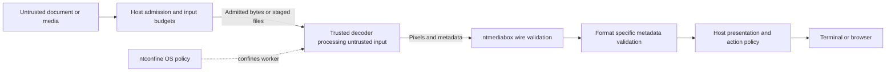

# Nimble Terminal security landscape

Website draft · 2026-11-05 · Proposed destination: nimbleterminal.com/security

Nimble Terminal libraries provide resource limits, isolated workers, OS
confinement, and validation of worker responses. The protection an application
gets depends on the APIs it selects, the permissions it grants, and the platform
where it runs. Importing a library with worker support does not enable workers
for every operation.

This landscape covers document and media processing and its connection to
application permissions, browser runtimes, and terminal output. Each project's
security policy defines its detailed contract. The companion
[boundary review](2026-11-05-security-landscape-review.md) records the source
snapshot and publication follow-up for this draft.

## Follow the input through the system

An application admits a file or URL, obtains bounded input, selects a processing
path, validates the result, and presents it. Embedded images, fonts, captions,
metadata, and links cross boundaries too.

This diagram describes the worker path. Direct rendering APIs execute in the
calling process instead. A worker remains untrusted from the host's perspective:
it can return misleading content even when every length and dimension is valid.

## Four protections with different jobs

| Protection | What it contributes | What remains outside it |
| --- | --- | --- |
| Bounded processing | Input, nesting, layout, pixel, cache, and work limits reduce resource exhaustion | Every internal allocation, aggregate concurrency, and parsers that ignore cancellation |
| Separate process | A worker can be terminated when it crashes, stalls, or exceeds a deadline | Restriction of its file and network permissions |
| OS confinement | Restricts the worker's access to files, networking, execution, and other system facilities according to policy | Kernel exploits, same-kernel side channels, and permissions deliberately granted by the host |
| Hostile response validation | Checks wire sizes, image dimensions, and format-specific metadata before using results | Authenticity of pixels, truth of extracted text, and authorization to follow a returned link |

These protections compose. A context deadline requires an effective termination
hook to stop an uncooperative worker. A checked image response does not authorize
a URL in its accompanying metadata. A per-request pixel cap is not a total
application memory budget.

## Where the libraries draw the boundary

| Component | Existing protection or worker entry point | Integration responsibility |
| --- | --- | --- |
| **ntconfine** | Verifies configured executables and policies, launches confined processes, reports support, and provides termination and reaping | Choose trusted binaries, narrow permissions, and an explicit policy when confinement is unavailable |
| **ntmediabox** | Streaming media and request/response rendering protocols; bounded frames and metadata; clients with termination hooks | Select the protocol, set useful budgets, connect effective cleanup, and validate application metadata |
| **ntpicture** | `decoders/worker` supports confined still-image decoding with byte, dimension, pixel, format, and timeout checks | Select worker decoding; its animation package remains a separate in-process path |
| **ntsvg** | `WorkerRendererFactory` moves SVG parsing, metadata extraction, and rasterization into a worker; the host validates returned metadata | Select the factory, coordinate host and worker limits, and close the loaded document's worker |
| **ntpdf** | `WorkerRendererFactory` moves preflight, text extraction, page metadata, and rasterization into a worker without host parsing fallback on confined-load failure | Select the factory; the default native path uses in-process PDF parsing and PDFium through wazero, not an OS-confined child |
| **nttypeset** | Engine budgets and bounded caches; `RasterWorker` checks raster and layout/link metadata; `ServeWorkerWithBuilder` can put document construction inside the worker | Put any untrusted parsing and asset decoding inside that boundary too; rendering already-parsed input cannot isolate the earlier parser |
| **ntvideo** | `WithWorker` provides software-only, silent playback in a worker; headless tools have a separate `HeadlessOptions.Sandbox` option | Select the relevant path; default native playback is in-process and a nil headless sandbox leaves tools unconfined |
| **nthtml** | Bounded HTML/CSS parsing, layout and diagram rendering; host-supplied resource interfaces | Choose where rendering runs and control resource admission; its document result is not interchangeable with an nttypeset worker result |

The worker paths already include protections beyond the common transport.
For example, SVG and PDF workers return validated metadata so the host need not
reparse the original markup or PDF to populate an information view. nttypeset
checks returned geometry and link structure. Preserve these checks when adapting
the libraries into an application.

See the project contracts for [ntconfine](https://github.com/NimbleTerminal/ntconfine/blob/main/SECURITY.md),
[ntmediabox](https://github.com/NimbleTerminal/ntmediabox/blob/main/SECURITY.md),
[ntpicture](https://github.com/NimbleTerminal/ntpicture#sandboxed-decoding),
[ntsvg](https://github.com/NimbleTerminal/ntsvg#confined-rendering-with-ntmediabox),
[ntpdf](https://github.com/NimbleTerminal/ntpdf/blob/main/SECURITY.md),
[nttypeset](https://github.com/NimbleTerminal/nttypeset/blob/main/SECURITY.md),
[ntvideo](https://github.com/NimbleTerminal/ntvideo/blob/main/SECURITY.md), and
[nthtml](https://github.com/NimbleTerminal/nthtml#readme).

## What the application still owns

The host decides which inputs may be opened, which URLs may be fetched, and which
external actions a user may request. A decoder's file-size check does not grant
permission to read that file. Prefer passing admitted bytes to a worker; where
a decoder needs files, stage or allowlist only the files it needs. Broad readable
directories enlarge the consequences of a compromised worker.

Set budgets for the whole operation: encoded input, expanded data, decoded pixels,
metadata, concurrent workers, queued requests, and retained results. Keep
host-side metadata parsing bounded. Worker strings and URLs remain untrusted;
sanitize for the destination and authorize actions separately. Raw render
metadata does not receive universal terminal or URL sanitization from ntmediabox.

Define failure behavior explicitly. A failed confined load should produce an
error or placeholder when confinement is required. Retrying through an
in-process decoder changes the boundary. Worker restart policy must also match
the host's process permissions. The streaming protocol does not provide a
universal playback deadline; the host decides what constitutes a stalled session.

## Applications can have different policies

**ntbrowser** admits network access through its network policy and freezes its
profile before processing pages. Native video runs in a helper started before
host lockdown. The host cannot spawn replacements afterward. Pure-Go images,
animations, diagrams, and HTML layout currently run in-process under their
respective budgets. Extending isolation requires covering embedded resources
and CSS backgrounds as well as top-level media, without opening native-code
permission in profiles that have it disabled.

**gloss** handles a wider range of local documents. It has parser subprocesses
for SVG, Mermaid, and PDF parsing, and optional worker video playback. These
paths do not establish uniform confinement across every format or operation.
Its current parser launcher permits unconfined fallback, while ordinary raster
and animation loading still has in-process paths. The library worker APIs offer
a route toward more consistent boundaries without inventing another transport.

Applications should describe their actual loading path and enforcement status,
rather than inheriting a blanket security claim from a dependency.

## Platform and deployment boundaries

On supported **Linux** systems, ntconfine uses Landlock and seccomp, with a
trusted stage executable where required. On **macOS**, it uses the deprecated
`sandbox-exec` facility. macOS does not provide the same address-space limit
enforcement; deadlines and protocol bounds do not become a hard RSS ceiling.
**Windows** currently lacks ntconfine OS confinement. An explicitly permitted
unconfined subprocess is a different operating mode. Probe support, handle
launch failures, and report what was applied.

**Browser WASM** runs under the browser's permission and runtime model. Browser
workers, CSP, origin policy, and exposed JavaScript bridges need their own review;
they are not the native ntmediabox subprocess boundary. Terminal rendering also
remains an output boundary: trusted presentation code decides which terminal
commands to emit, and document text must not become arbitrary escape sequences.

For **hosted or multi-tenant services**, add deployment controls for tenant
separation, credentials, storage, network access, and aggregate CPU and memory.
These libraries confine trusted programs processing untrusted input. They do not
make arbitrary helper binaries trustworthy or provide a complete tenant-isolation
architecture.

## Evidence and reporting

Look for tests of the boundary being claimed: malformed worker responses,
oversized metadata, cancellation and child reaping, and real OS denial of file,
network, and terminal access. In-memory protocol tests and fuzzing are valuable,
but do not prove OS confinement. A test skipped because confinement is unavailable
does not establish enforcement on that deployment.

Report vulnerabilities privately using the affected project's security policy.
The policies linked above currently direct reports to **security@neomantra.net**.
Include the version, platform, selected loading path, enforcement status, and a
minimal reproduction.
